# M0: 20 events across the story's threads, converging on Cal's reveal

Picked from the model's knowledge of the novel, not the text; each event needs the reader's check. Prompt `c62d16555d5ea0af`. 0/20 events checked by the reader. Open `graph.html` for the swimlanes.

```mermaid
flowchart LR
    subgraph lane_n_Cathy_Kate["Cathy/Kate"]
        n_cathy_burns_home["Cathy Ames burns her parents' house and vanishes<br/><i>Ch. 8</i>"]
        n_edwards_beats_cathy["Mr. Edwards nearly beats Cathy to death<br/><i>Ch. 9</i>"]
        n_cathy_reaches_trasks["The battered Cathy reaches the Trask farm<br/><i>Ch. 10</i>"]
        n_cathy_drugs_adam["On the wedding night Cathy drugs Adam and goes to Charles<br/><i>Ch. 11</i>"]
        n_cathy_shoots_adam["Cathy shoots Adam and abandons her family<br/><i>Ch. 17</i>"]
        n_cathy_joins_faye["Cathy becomes 'Kate' at Faye's brothel in Salinas<br/><i>Ch. 19</i>"]
        n_kate_takes_faye_house["Faye dies and Kate takes over the brothel<br/><i>Ch. 21</i>"]
    end
    subgraph lane_n_Trask["Trask"]
        n_adam_marries_cathy["Adam marries Cathy and plans to go to California<br/><i>Ch. 11</i>"]
        n_adam_visits_kate["Adam confronts Kate after Samuel's funeral<br/><i>Ch. 25</i>"]
        n_move_to_salinas["The Trasks move to Salinas<br/><i>Ch. 35</i>"]
        n_lettuce_fails["Adam's refrigerated lettuce venture fails<br/><i>Ch. 37</i>"]
        n_cal_confronts_kate["Cal visits Kate and rejects her<br/><i>Ch. 42</i>"]
        n_cal_borrows_from_kate["Cal borrows five thousand dollars from Kate<br/><i>Ch. 43</i>"]
        n_gift_rejected["Adam rejects Cal's gift of money<br/><i>Ch. 49</i>"]
        n_cal_reveals_kate_to_aron["Cal takes Aron to Kate's house and reveals their mother<br/><i>Ch. 49</i>"]
    end
    subgraph lane_n_Hamilton["Hamilton"]
        n_twins_born["Samuel delivers Cathy's twins<br/><i>Ch. 17</i>"]
        n_twins_named["Samuel shakes Adam awake and the twins are named<br/><i>Ch. 22</i>"]
        n_samuel_tells_adam["Samuel tells Adam where Cathy is<br/><i>Ch. 24</i>"]
        n_will_bean_deal["Cal partners with Will Hamilton to speculate in beans<br/><i>Ch. 43</i>"]
    end
    subgraph lane_n_Lee["Lee"]
        n_cal_learns_mother["Cal discovers his mother is alive and runs a brothel<br/><i>Ch. 38</i>"]
    end
    n_cathy_burns_home --> n_edwards_beats_cathy
    n_edwards_beats_cathy --> n_cathy_reaches_trasks
    n_cathy_reaches_trasks --> n_adam_marries_cathy
    n_adam_marries_cathy --> n_cathy_drugs_adam
    n_adam_marries_cathy --> n_twins_born
    n_cathy_drugs_adam --> n_twins_born
    n_twins_born --> n_cathy_shoots_adam
    n_cathy_shoots_adam --> n_cathy_joins_faye
    n_cathy_joins_faye --> n_kate_takes_faye_house
    n_cathy_shoots_adam --> n_twins_named
    n_kate_takes_faye_house --> n_samuel_tells_adam
    n_twins_named --> n_samuel_tells_adam
    n_samuel_tells_adam --> n_adam_visits_kate
    n_cathy_drugs_adam --> n_adam_visits_kate
    n_adam_visits_kate --> n_move_to_salinas
    n_adam_visits_kate --> n_lettuce_fails
    n_move_to_salinas --> n_lettuce_fails
    n_move_to_salinas --> n_cal_learns_mother
    n_kate_takes_faye_house --> n_cal_learns_mother
    n_cal_learns_mother --> n_cal_confronts_kate
    n_lettuce_fails --> n_will_bean_deal
    n_cal_confronts_kate --> n_cal_borrows_from_kate
    n_will_bean_deal --> n_cal_borrows_from_kate
    n_will_bean_deal --> n_gift_rejected
    n_cal_borrows_from_kate --> n_gift_rejected
    n_lettuce_fails --> n_gift_rejected
    n_gift_rejected --> n_cal_reveals_kate_to_aron
    n_cal_confronts_kate --> n_cal_reveals_kate_to_aron
    n_cal_learns_mother --> n_cal_reveals_kate_to_aron
    style n_cal_reveals_kate_to_aron stroke-width:3px
```

| # | Event | Thread | Ch. | Caused by | Search phrase | Why it matters | Checked |
|---|---|---|---|---|---|---|---|
| 1 | **Cathy Ames burns her parents' house and vanishes** | Cathy/Kate | 8 | (starts a thread) | “monsters born in the world” | This shows Cathy's ruthless nature and starts her life apart from any family. That life leads to the hidden identity Cal later exposes. | unchecked |
| 2 | **Mr. Edwards nearly beats Cathy to death** | Cathy/Kate | 9 | Cathy Ames burns her parents' house and vanishes | “Mr. Edwards” | The beating leaves Cathy helpless near the Trask farm, which is how she enters Adam's life. | unchecked |
| 3 | **The battered Cathy reaches the Trask farm** | Cathy/Kate | 10 | Mr. Edwards nearly beats Cathy to death | “Cathy Ames” | Without this meeting, Cathy would never become Adam's wife and the twins' mother. | unchecked |
| 4 | **Adam marries Cathy and plans to go to California** | Trask | 11 | The battered Cathy reaches the Trask farm | “California” | The marriage makes Cathy the mother of Adam's sons and brings her to the Salinas Valley. | unchecked |
| 5 | **On the wedding night Cathy drugs Adam and goes to Charles** | Cathy/Kate | 11 | Adam marries Cathy and plans to go to California | “the medicine” | This betrayal is the secret Kate later uses to taunt Adam. It is part of the shameful truth about their mother that Cal forces on Aron. | unchecked |
| 6 | **Samuel delivers Cathy's twins** | Hamilton | 17 | Adam marries Cathy and plans to go to California, On the wedding night Cathy drugs Adam and goes to Charles | “twins” | Cal and Aron are born here, and the focal scene happens between these two sons. | unchecked |
| 7 | **Cathy shoots Adam and abandons her family** | Cathy/Kate | 17 | Samuel delivers Cathy's twins | “forty-four” | The boys grow up without their mother, and her disappearance becomes the family secret Cal later exposes. | unchecked |
| 8 | **Cathy becomes 'Kate' at Faye's brothel in Salinas** | Cathy/Kate | 19 | Cathy shoots Adam and abandons her family | “Faye's” | This gives her the new identity and the Salinas location where her sons will one day find her. | unchecked |
| 9 | **Faye dies and Kate takes over the brothel** | Cathy/Kate | 21 | Cathy becomes 'Kate' at Faye's brothel in Salinas | “the will” | Kate's house is the very place Cal later takes Aron to show him their mother. | unchecked |
| 10 | **Samuel shakes Adam awake and the twins are named** | Hamilton | 22 | Cathy shoots Adam and abandons her family | “Cain and Abel” | The naming sets up the Cain-and-Abel rivalry between the brothers, which climaxes in Cal's attack on Aron. | unchecked |
| 11 | **Samuel tells Adam where Cathy is** | Hamilton | 24 | Faye dies and Kate takes over the brothel, Samuel shakes Adam awake and the twins are named | “Thou mayest” | Adam learns Kate's identity and is pushed to face her, which breaks his long paralysis. | unchecked |
| 12 | **Adam confronts Kate after Samuel's funeral** | Trask | 25 | Samuel tells Adam where Cathy is, On the wedding night Cathy drugs Adam and goes to Charles | “funeral” | Freed of his obsession, Adam returns to life and to his sons, while still keeping their mother a secret from them. | unchecked |
| 13 | **The Trasks move to Salinas** | Trask | 35 | Adam confronts Kate after Samuel's funeral | “Salinas” | Living in Salinas puts the twins in the same town as Kate's brothel, which makes both Cal's discovery and the final visit possible. | unchecked |
| 14 | **Adam's refrigerated lettuce venture fails** | Trask | 37 | Adam confronts Kate after Samuel's funeral, The Trasks move to Salinas | “lettuce” | Cal later tries to win his father's love by replacing the lost money. | unchecked |
| 15 | **Cal discovers his mother is alive and runs a brothel** | Lee | 38 | The Trasks move to Salinas, Faye dies and Kate takes over the brothel | “Rabbit Holman” | Cal now holds the secret that he will later use against Aron. | unchecked |
| 16 | **Cal visits Kate and rejects her** | Trask | 42 | Cal discovers his mother is alive and runs a brothel | “I don't have to be you” | Cal learns the way to Kate's house and gains a bond with her that he can draw on later. | unchecked |
| 17 | **Cal partners with Will Hamilton to speculate in beans** | Hamilton | 43 | Adam's refrigerated lettuce venture fails | “beans” | This venture produces the money Cal offers Adam as a gift. | unchecked |
| 18 | **Cal borrows five thousand dollars from Kate** | Trask | 43 | Cal visits Kate and rejects her, Cal partners with Will Hamilton to speculate in beans | “five thousand dollars” | Kate's money funds Cal's gift, so her thread feeds directly into the rejection that drives Cal to expose her. | unchecked |
| 19 | **Adam rejects Cal's gift of money** | Trask | 49 | Cal partners with Will Hamilton to speculate in beans, Cal borrows five thousand dollars from Kate, Adam's refrigerated lettuce venture fails | “fifteen thousand dollars” | This rejection, a Cain-like spurning of his offering, provokes Cal's jealous revenge on his brother. | unchecked |
| 20 | **Cal takes Aron to Kate's house and reveals their mother** | Trask | 49 | Adam rejects Cal's gift of money, Cal visits Kate and rejects her, Cal discovers his mother is alive and runs a brothel | “I want to show you something” | This is the focal event, where the Trask and Cathy/Kate threads converge. | unchecked |
