# M1: the events the ending really depends on

Pool picked from the model's knowledge of the novel, not the text; 0/35 checked by the reader. Pool prompt `098852498603b60d`, judge input `457e0bc28a0c6ac0`.

Not judged yet: 35 candidates, all shown. Run `python -m eden judge` to apply the significance test.

The reference set is empty: add your own picks to `output/m1/reference.json`.

The full pool; faded, dashed boxes are the events most runs cut. Open `graph.html` for the swimlanes of the kept events only.

```mermaid
flowchart LR
    n_samuel_arrives["Samuel Hamilton settles in the Salinas Valley<br/><i>Ch. 2</i>"]
    n_cyrus_dies_fortune["Cyrus Trask dies leaving a large fortune<br/><i>Ch. 7</i>"]
    n_cathy_burns_home["Cathy burns her parents' house and fakes her death<br/><i>Ch. 8</i>"]
    n_edwards_beats_cathy["Mr. Edwards beats Cathy nearly to death<br/><i>Ch. 9</i>"]
    n_cathy_on_porch["Injured Cathy turns up at the Trask farmhouse<br/><i>Ch. 10</i>"]
    n_adam_marries_cathy["Adam marries Cathy<br/><i>Ch. 11</i>"]
    n_cathy_sleeps_charles["Cathy drugs Adam and goes to Charles on the wedding night<br/><i>Ch. 11</i>"]
    n_adam_buys_ranch["Adam buys the Bordoni ranch<br/><i>Ch. 13</i>"]
    n_samuel_visits_ranch["Samuel comes to plan Adam's wells<br/><i>Ch. 15</i>"]
    n_lee_drops_pidgin["Lee drops his pidgin with Samuel<br/><i>Ch. 15</i>"]
    n_twins_born["Samuel delivers the twins and Cathy bites him<br/><i>Ch. 17</i>"]
    n_cathy_shoots_adam["Cathy shoots Adam and abandons the family<br/><i>Ch. 17</i>"]
    n_quinn_investigates["Horace Quinn investigates the shooting<br/><i>Ch. 18</i>"]
    n_cathy_joins_faye["Cathy goes to work at Faye's brothel as Kate<br/><i>Ch. 19</i>"]
    n_kate_poisons_faye["Kate poisons Faye and takes over the brothel<br/><i>Ch. 21</i>"]
    n_samuel_strikes_adam["Samuel strikes Adam out of his stupor<br/><i>Ch. 22</i>"]
    n_twins_named["The twins are named Caleb and Aron<br/><i>Ch. 22</i>"]
    n_samuel_farewell["Samuel, aging after Una's death, agrees to leave his ranch<br/><i>Ch. 23</i>"]
    n_samuel_tells_kate["Samuel tells Adam that Cathy runs a Salinas brothel<br/><i>Ch. 24</i>"]
    n_adam_visits_kate["Adam confronts Kate and is freed of her<br/><i>Ch. 25</i>"]
    n_aron_rabbit_abra["Aron gives Abra a rabbit<br/><i>Ch. 27</i>"]
    n_abra_mother_alive["Abra tells Aron his mother may be alive<br/><i>Ch. 27</i>"]
    n_move_salinas["Adam moves the family to Salinas<br/><i>Ch. 35</i>"]
    n_lettuce_fails["Adam's iced-lettuce venture fails<br/><i>Ch. 36</i>"]
    n_aron_religious["Aron turns to the church<br/><i>Ch. 37</i>"]
    n_cal_arrested["Cal is picked up in a Chinatown raid<br/><i>Ch. 38</i>"]
    n_adam_tells_cal["Adam tells Cal the truth about his mother<br/><i>Ch. 38</i>"]
    n_cal_follows_kate["Cal shadows Kate around Salinas<br/><i>Ch. 39</i>"]
    n_cal_confronts_kate["Cal confronts Kate in her room<br/><i>Ch. 39</i>"]
    n_war_draft_board["America enters the war; Adam joins the draft board<br/><i>Ch. 42</i>"]
    n_lee_lends["Lee lends Cal five thousand dollars<br/><i>Ch. 43</i>"]
    n_bean_deal["Cal and Will Hamilton profit from beans<br/><i>Ch. 43</i>"]
    n_aron_stanford["Aron leaves for Stanford<br/><i>Ch. 45</i>"]
    n_thanksgiving_rejection["Adam rejects Cal's Thanksgiving gift<br/><i>Ch. 49</i>"]
    n_cal_reveals_kate["Cal takes Aron to Kate's house<br/><i>Ch. 49</i>"]
    n_cathy_burns_home --> n_edwards_beats_cathy
    n_edwards_beats_cathy --> n_cathy_on_porch
    n_cyrus_dies_fortune --> n_cathy_on_porch
    n_cathy_on_porch --> n_adam_marries_cathy
    n_adam_marries_cathy --> n_cathy_sleeps_charles
    n_adam_marries_cathy --> n_adam_buys_ranch
    n_cyrus_dies_fortune --> n_adam_buys_ranch
    n_samuel_arrives --> n_samuel_visits_ranch
    n_adam_buys_ranch --> n_samuel_visits_ranch
    n_samuel_visits_ranch --> n_lee_drops_pidgin
    n_cathy_sleeps_charles --> n_twins_born
    n_adam_buys_ranch --> n_twins_born
    n_samuel_visits_ranch --> n_twins_born
    n_twins_born --> n_cathy_shoots_adam
    n_cathy_shoots_adam --> n_quinn_investigates
    n_cathy_shoots_adam --> n_cathy_joins_faye
    n_cathy_joins_faye --> n_kate_poisons_faye
    n_cathy_shoots_adam --> n_samuel_strikes_adam
    n_samuel_visits_ranch --> n_samuel_strikes_adam
    n_samuel_strikes_adam --> n_twins_named
    n_lee_drops_pidgin --> n_twins_named
    n_samuel_arrives --> n_samuel_farewell
    n_samuel_farewell --> n_samuel_tells_kate
    n_kate_poisons_faye --> n_samuel_tells_kate
    n_twins_named --> n_samuel_tells_kate
    n_samuel_tells_kate --> n_adam_visits_kate
    n_twins_named --> n_aron_rabbit_abra
    n_aron_rabbit_abra --> n_abra_mother_alive
    n_quinn_investigates --> n_abra_mother_alive
    n_adam_visits_kate --> n_move_salinas
    n_cyrus_dies_fortune --> n_lettuce_fails
    n_move_salinas --> n_lettuce_fails
    n_move_salinas --> n_aron_religious
    n_move_salinas --> n_cal_arrested
    n_cal_arrested --> n_adam_tells_cal
    n_adam_visits_kate --> n_adam_tells_cal
    n_adam_tells_cal --> n_cal_follows_kate
    n_cal_follows_kate --> n_cal_confronts_kate
    n_kate_poisons_faye --> n_cal_confronts_kate
    n_lettuce_fails --> n_lee_lends
    n_lettuce_fails --> n_bean_deal
    n_lee_lends --> n_bean_deal
    n_war_draft_board --> n_bean_deal
    n_aron_religious --> n_aron_stanford
    n_bean_deal --> n_thanksgiving_rejection
    n_war_draft_board --> n_thanksgiving_rejection
    n_aron_stanford --> n_thanksgiving_rejection
    n_thanksgiving_rejection --> n_cal_reveals_kate
    n_cal_confronts_kate --> n_cal_reveals_kate
    n_aron_religious --> n_cal_reveals_kate
    n_abra_mother_alive --> n_cal_reveals_kate
    style n_cal_reveals_kate stroke-width:3px
```

| # | Event | Thread | Ch. | Kept | Effect if removed | Affects | Judge's reason | Checked |
|---|---|---|---|---|---|---|---|---|
| 1 | **Samuel Hamilton settles in the Salinas Valley** | Hamilton | 2 | not judged yet |  |  |  | unchecked |
| 2 | **Cyrus Trask dies leaving a large fortune** | Trask | 7 | not judged yet |  |  |  | unchecked |
| 3 | **Cathy burns her parents' house and fakes her death** | Cathy/Kate | 8 | not judged yet |  |  |  | unchecked |
| 4 | **Mr. Edwards beats Cathy nearly to death** | Cathy/Kate | 9 | not judged yet |  |  |  | unchecked |
| 5 | **Injured Cathy turns up at the Trask farmhouse** | Cathy/Kate | 10 | not judged yet |  |  |  | unchecked |
| 6 | **Adam marries Cathy** | Trask | 11 | not judged yet |  |  |  | unchecked |
| 7 | **Cathy drugs Adam and goes to Charles on the wedding night** | Cathy/Kate | 11 | not judged yet |  |  |  | unchecked |
| 8 | **Adam buys the Bordoni ranch** | Trask | 13 | not judged yet |  |  |  | unchecked |
| 9 | **Samuel comes to plan Adam's wells** | Hamilton | 15 | not judged yet |  |  |  | unchecked |
| 10 | **Lee drops his pidgin with Samuel** | Lee | 15 | not judged yet |  |  |  | unchecked |
| 11 | **Samuel delivers the twins and Cathy bites him** | Hamilton | 17 | not judged yet |  |  |  | unchecked |
| 12 | **Cathy shoots Adam and abandons the family** | Cathy/Kate | 17 | not judged yet |  |  |  | unchecked |
| 13 | **Horace Quinn investigates the shooting** | Trask | 18 | not judged yet |  |  |  | unchecked |
| 14 | **Cathy goes to work at Faye's brothel as Kate** | Cathy/Kate | 19 | not judged yet |  |  |  | unchecked |
| 15 | **Kate poisons Faye and takes over the brothel** | Cathy/Kate | 21 | not judged yet |  |  |  | unchecked |
| 16 | **Samuel strikes Adam out of his stupor** | Hamilton | 22 | not judged yet |  |  |  | unchecked |
| 17 | **The twins are named Caleb and Aron** | Lee | 22 | not judged yet |  |  |  | unchecked |
| 18 | **Samuel, aging after Una's death, agrees to leave his ranch** | Hamilton | 23 | not judged yet |  |  |  | unchecked |
| 19 | **Samuel tells Adam that Cathy runs a Salinas brothel** | Hamilton | 24 | not judged yet |  |  |  | unchecked |
| 20 | **Adam confronts Kate and is freed of her** | Trask | 25 | not judged yet |  |  |  | unchecked |
| 21 | **Aron gives Abra a rabbit** | Trask | 27 | not judged yet |  |  |  | unchecked |
| 22 | **Abra tells Aron his mother may be alive** | Trask | 27 | not judged yet |  |  |  | unchecked |
| 23 | **Adam moves the family to Salinas** | Trask | 35 | not judged yet |  |  |  | unchecked |
| 24 | **Adam's iced-lettuce venture fails** | Trask | 36 | not judged yet |  |  |  | unchecked |
| 25 | **Aron turns to the church** | Trask | 37 | not judged yet |  |  |  | unchecked |
| 26 | **Cal is picked up in a Chinatown raid** | Trask | 38 | not judged yet |  |  |  | unchecked |
| 27 | **Adam tells Cal the truth about his mother** | Trask | 38 | not judged yet |  |  |  | unchecked |
| 28 | **Cal shadows Kate around Salinas** | Trask | 39 | not judged yet |  |  |  | unchecked |
| 29 | **Cal confronts Kate in her room** | Trask | 39 | not judged yet |  |  |  | unchecked |
| 30 | **America enters the war; Adam joins the draft board** | Trask | 42 | not judged yet |  |  |  | unchecked |
| 31 | **Lee lends Cal five thousand dollars** | Lee | 43 | not judged yet |  |  |  | unchecked |
| 32 | **Cal and Will Hamilton profit from beans** | Trask | 43 | not judged yet |  |  |  | unchecked |
| 33 | **Aron leaves for Stanford** | Trask | 45 | not judged yet |  |  |  | unchecked |
| 34 | **Adam rejects Cal's Thanksgiving gift** | Trask | 49 | not judged yet |  |  |  | unchecked |
| 35 | **Cal takes Aron to Kate's house** | Trask | 49 | not judged yet |  |  |  | unchecked |
