# M1: the events that made Cal who he is

Pool picked from the model's knowledge of the novel, not the text; 30/30 checked by the reader, 30 true. Pool prompt `428c3e46ef1d4fc7`, judge input `880fa683ce19a9e1`.

5 judge run(s) over 30 candidates. Kept per run: 18, 19, 19, 19, 19; runs agree 98% on average (shared keeps / all keeps, per pair). Kept by most runs: **19 of 30**, drawn below.

Your reference set has 4 events. The pool contains 4 of them (recall 100%), and the judge keeps 3.

In the pool but cut by the judge: Cathy marries Adam and goes to Charles on the wedding night.

Kept by the judge but not on your list: Cathy Ames is introduced as a born monster; Cathy shoots Adam and abandons the twins; Cathy becomes 'Kate' at Faye's brothel in Salinas; Adam sinks into apathy while Lee raises the twins; Lee's elders arrive at 'timshel', thou mayest; Abra visits and warms to Aron's gift; Abra tells Aron his mother is not dead; Cal prays not to be mean; Aron turns devout and plans the ministry; Lee tells Cal the truth and that his choices are his own; Cal follows Kate and confronts her; Adam serves on the wartime draft board; Cal partners with Will Hamilton to grow beans; Adam glows with pride over Aron's college plans; Cal makes a fortune and plans a Thanksgiving gift.

The full pool; faded, dashed boxes are the events most runs cut. Open `graph.html` for the swimlanes of the kept events only.

```mermaid
flowchart LR
    n_cathy_born_monster["Cathy Ames is introduced as a born monster<br/><i>Ch. 8</i>"]
    n_cathy_wedding_night["Cathy marries Adam and goes to Charles on the wedding night<br/><i>Ch. 11</i>"]
    n_twins_born["The twins are born and Cathy rejects them<br/><i>Ch. 17</i>"]
    n_cathy_shoots_adam["Cathy shoots Adam and abandons the twins<br/><i>Ch. 17</i>"]
    n_adam_covers_shooting["Adam hides the truth about the shooting<br/><i>Ch. 18</i>"]
    n_cathy_becomes_kate["Cathy becomes 'Kate' at Faye's brothel in Salinas<br/><i>Ch. 19</i>"]
    n_adam_stupor_lee_raises["Adam sinks into apathy while Lee raises the twins<br/><i>Ch. 22</i>"]
    n_samuel_strikes_adam["Samuel strikes Adam to wake him<br/><i>Ch. 22</i>"]
    n_naming_cain_abel["The twins are named after a talk about Cain and Abel<br/><i>Ch. 22</i>"]
    n_lee_rejection_speech["Lee explains that rejection breeds rage and guilt<br/><i>Ch. 24</i>"]
    n_timshel["Lee's elders arrive at 'timshel', thou mayest<br/><i>Ch. 24</i>"]
    n_samuel_tells_adam_kate["Samuel tells Adam that Cathy runs a Salinas brothel<br/><i>Ch. 24</i>"]
    n_adam_visits_kate["Adam confronts Kate and is freed from her<br/><i>Ch. 25</i>"]
    n_bradley_visit_rabbit["Abra visits and warms to Aron's gift<br/><i>Ch. 27</i>"]
    n_abra_tells_aron_mother["Abra tells Aron his mother is not dead<br/><i>Ch. 27</i>"]
    n_cal_prayer["Cal prays not to be mean<br/><i>Ch. 27</i>"]
    n_lettuce_failure["Adam's iced-lettuce venture fails<br/><i>Ch. 36</i>"]
    n_aron_turns_religious["Aron turns devout and plans the ministry<br/><i>Ch. 37</i>"]
    n_cal_learns_of_kate["Cal discovers that the madam Kate is his mother<br/><i>Ch. 38</i>"]
    n_lee_tells_cal["Lee tells Cal the truth and that his choices are his own<br/><i>Ch. 39</i>"]
    n_cal_meets_kate["Cal follows Kate and confronts her<br/><i>Ch. 40</i>"]
    n_adam_draft_board["Adam serves on the wartime draft board<br/><i>Ch. 42</i>"]
    n_cal_will_beans["Cal partners with Will Hamilton to grow beans<br/><i>Ch. 43</i>"]
    n_lee_lends_cal["Lee lends Cal the money to start<br/><i>Ch. 43</i>"]
    n_adam_pride_aron["Adam glows with pride over Aron's college plans<br/><i>Ch. 44</i>"]
    n_aron_leaves_stanford["Aron goes away to Stanford<br/><i>Ch. 46</i>"]
    n_cal_readies_gift["Cal makes a fortune and plans a Thanksgiving gift<br/><i>Ch. 48</i>"]
    n_adam_rejects_gift["Adam rejects Cal's money and praises Aron instead<br/><i>Ch. 49</i>"]
    n_lee_after_rejection["Lee tries to steady Cal after the rejection<br/><i>Ch. 49</i>"]
    n_cal_reveals_kate_to_aron["Cal takes Aron to Kate's house and shows him their mother<br/><i>Ch. 49</i>"]
    n_cathy_born_monster --> n_cathy_wedding_night
    n_cathy_wedding_night --> n_twins_born
    n_twins_born --> n_cathy_shoots_adam
    n_cathy_shoots_adam --> n_adam_covers_shooting
    n_cathy_shoots_adam --> n_cathy_becomes_kate
    n_cathy_shoots_adam --> n_adam_stupor_lee_raises
    n_adam_stupor_lee_raises --> n_samuel_strikes_adam
    n_samuel_strikes_adam --> n_naming_cain_abel
    n_naming_cain_abel --> n_lee_rejection_speech
    n_naming_cain_abel --> n_timshel
    n_cathy_becomes_kate --> n_samuel_tells_adam_kate
    n_samuel_strikes_adam --> n_samuel_tells_adam_kate
    n_samuel_tells_adam_kate --> n_adam_visits_kate
    n_twins_born --> n_bradley_visit_rabbit
    n_bradley_visit_rabbit --> n_abra_tells_aron_mother
    n_adam_covers_shooting --> n_abra_tells_aron_mother
    n_bradley_visit_rabbit --> n_cal_prayer
    n_abra_tells_aron_mother --> n_cal_prayer
    n_adam_visits_kate --> n_lettuce_failure
    n_abra_tells_aron_mother --> n_aron_turns_religious
    n_cathy_becomes_kate --> n_cal_learns_of_kate
    n_abra_tells_aron_mother --> n_cal_learns_of_kate
    n_cal_prayer --> n_cal_learns_of_kate
    n_cal_learns_of_kate --> n_lee_tells_cal
    n_timshel --> n_lee_tells_cal
    n_lee_rejection_speech --> n_lee_tells_cal
    n_cal_learns_of_kate --> n_cal_meets_kate
    n_lee_tells_cal --> n_cal_meets_kate
    n_adam_visits_kate --> n_adam_draft_board
    n_lettuce_failure --> n_cal_will_beans
    n_adam_draft_board --> n_cal_will_beans
    n_cal_will_beans --> n_lee_lends_cal
    n_lee_tells_cal --> n_lee_lends_cal
    n_aron_turns_religious --> n_adam_pride_aron
    n_adam_pride_aron --> n_aron_leaves_stanford
    n_lee_lends_cal --> n_cal_readies_gift
    n_aron_leaves_stanford --> n_cal_readies_gift
    n_cal_readies_gift --> n_adam_rejects_gift
    n_adam_draft_board --> n_adam_rejects_gift
    n_adam_pride_aron --> n_adam_rejects_gift
    n_adam_rejects_gift --> n_lee_after_rejection
    n_lee_tells_cal --> n_lee_after_rejection
    n_adam_rejects_gift --> n_cal_reveals_kate_to_aron
    n_lee_after_rejection --> n_cal_reveals_kate_to_aron
    n_cal_meets_kate --> n_cal_reveals_kate_to_aron
    n_aron_turns_religious --> n_cal_reveals_kate_to_aron
    n_lee_rejection_speech --> n_cal_reveals_kate_to_aron
    classDef cut stroke-dasharray:4 3,opacity:0.45
    class n_cathy_wedding_night,n_twins_born,n_adam_covers_shooting,n_samuel_strikes_adam,n_naming_cain_abel,n_lee_rejection_speech,n_samuel_tells_adam_kate,n_adam_visits_kate,n_lee_lends_cal,n_aron_leaves_stanford,n_lee_after_rejection cut
    style n_cal_reveals_kate_to_aron stroke-width:3px
```

| # | Event | What it does to Cal | Ch. | Kept | Without it, Cal… | Affects | Judge's reason | Checked |
|---|---|---|---|---|---|---|---|---|
| 1 | **Cathy Ames is introduced as a born monster** | Cal will one day learn that his mother is this woman, and fear that her coldness lives in him. | 8 | 5/5 | changes who he is | Cal discovers that the madam Kate is his mother, Lee tells Cal the truth and that his choices are his own, Cal follows Kate and confronts her, Cal takes Aron to Kate's house and shows him their mother | Cathy's monstrous nature is what Cal fears he has inherited. It is also what makes the truth about her a weapon. Without it, his mother would not be a source of shame and dread for him. | ✓ checked |
| 2 | **Cathy marries Adam and goes to Charles on the wedding night** | Cal is born from a marriage built on his mother's deceit, a secret kept from him. | 11 | 0/5 | no real change |  | Cal never learns of the drugging or of Charles. His sense of himself at the reveal does not depend on it. | ✓ checked |
| 3 | **The twins are born and Cathy rejects them** | From birth Cal is unwanted by his mother, though he will not know it for years. | 17 | 0/5 | no real change |  | The birth is needed for Cal to exist. But Cathy's indifference at the delivery is unknown to him and does not shape his motives. | ✓ checked |
| 4 | **Cathy shoots Adam and abandons the twins** | Cal loses his mother as a baby and grows up without knowing why. | 17 | 5/5 | changes who he is | Abra tells Aron his mother is not dead, Cal discovers that the madam Kate is his mother, Lee tells Cal the truth and that his choices are his own, Cal follows Kate and confronts her | Her abandonment makes Cal a motherless boy raised on a false story. That gap and that lie are what he later uncovers and turns against Aron. | ✓ checked |
| 5 | **Adam hides the truth about the shooting** | The silence that will surround Cal's mother throughout his childhood begins here. | 18 | 0/5 | no real change |  | Adam's lie to the deputy is legal concealment that Cal never knows about. The silence the boys grow up with comes from later choices. | ✓ checked |
| 6 | **Cathy becomes 'Kate' at Faye's brothel in Salinas** | Cal's mother is living a few miles away under a new name, a secret waiting for him. | 19 | 5/5 | changes his choice | Cal discovers that the madam Kate is his mother, Cal follows Kate and confronts her, Cal takes Aron to Kate's house and shows him their mother | Because his mother is a Salinas brothel madam, the truth carries the shame that can shatter pure Aron. Without that, there is nothing for Cal to take him to. | ✓ checked |
| 7 | **Adam sinks into apathy while Lee raises the twins** | Cal's first years are spent with an absent-minded father and a loving servant, Lee, in his place. | 22 | 5/5 | changes who he is | Lee tells Cal the truth and that his choices are his own, Lee lends Cal the money to start, Lee tries to steady Cal after the rejection | Adam's withdrawal leaves Lee as Cal's true guide and confidant. It also starts Cal's lifelong hunger for his distant father's attention. | ✓ checked |
| 8 | **Samuel strikes Adam to wake him** | Cal's father is forced to start paying attention to him, but only partly. | 22 | 0/5 | no real change |  | The blow wakes Adam enough to name the boys. It moves the plot but leaves no mark Cal carries to the reveal. | ✓ checked |
| 9 | **The twins are named after a talk about Cain and Abel** | Cal is given a name tied to the Cain-and-Abel story he will half-live out with Aron. | 22 | 0/5 | no real change |  | The naming talk is thematic framing among the adults. Cal's motives at the reveal come from what is later done to him, not from this conversation. | ✓ checked |
| 10 | **Lee explains that rejection breeds rage and guilt** | Lee forms an idea of the rejected son that will guide how he raises and counsels Cal. | 24 | 0/5 | no real change |  | Lee's speech diagnoses the rejected son's rage but is never heard by Cal. It explains his act rather than forming him. | ✓ checked |
| 11 | **Lee's elders arrive at 'timshel', thou mayest** | Lee forms the belief in personal choice that he will later pass on to Cal. | 24 | 5/5 | changes who he is | Lee tells Cal the truth and that his choices are his own, Cal follows Kate and confronts her, Lee tries to steady Cal after the rejection, Cal takes Aron to Kate's house and shows him their mother | Through Lee, timshel gives Cal the belief that his deeds are his own and not his mother's blood. So he strikes at Aron knowing the act is his choice. | ✓ checked |
| 12 | **Samuel tells Adam that Cathy runs a Salinas brothel** | The adults around Cal now know his mother's whereabouts and will keep it from him. | 24 | 0/5 | no real change |  | This frees Adam but touches Cal only through plot. Cal's discovery of Kate comes through other channels. | ✓ checked |
| 13 | **Adam confronts Kate and is freed from her** | Cal's father comes back to life but keeps the truth about Cal's mother locked away. | 25 | 0/5 | no real change |  | Adam's release from Cathy restarts his ambitions. For Cal it is only a plot link to later events. | ✓ checked |
| 14 | **Abra visits and warms to Aron's gift** | Cal feels that people naturally love Aron more than him, and resents it. | 27 | 5/5 | changes who he is | Cal prays not to be mean | Watching Abra warm to gentle Aron while he is pushed aside plants Cal's conviction that people naturally love his brother more. That jealousy drives the reveal. | ✓ checked |
| 15 | **Abra tells Aron his mother is not dead** | Cal begins to sense that the story of his dead mother may be a lie. | 27 | 5/5 | changes who he is | Cal prays not to be mean, Cal discovers that the madam Kate is his mother | Abra's news first makes Cal suspect the dead-mother story is a lie. It sets him searching for what the adults are hiding. | ✓ checked |
| 16 | **Cal prays not to be mean** | Cal fears he is mean by nature and desperately wants to be loved like Aron. | 27 | 4/5 | changes who he is | Cal discovers that the madam Kate is his mother, Lee tells Cal the truth and that his choices are his own, Cal follows Kate and confronts her, Cal takes Aron to Kate's house and shows him their mother | The prayer shows Cal already fearing he is mean by nature and aching to be loved like Aron. That fear and longing are the inner wound the reveal comes from. | ✓ checked |
| 17 | **Adam's iced-lettuce venture fails** | Cal sees his father humiliated and poorer, and later wants to make it up to him. | 36 | 5/5 | changes his choice | Cal partners with Will Hamilton to grow beans, Lee lends Cal the money to start, Cal makes a fortune and plans a Thanksgiving gift, Adam rejects Cal's money and praises Aron instead, Cal takes Aron to Kate's house and shows him their mother | Adam's loss gives Cal his plan to win his father by restoring the money. Without it there is no gift, no rejection and no night of revenge. | ✓ checked |
| 18 | **Aron turns devout and plans the ministry** | Cal watches his brother build a pure, protected world that the truth about their mother could shatter. | 37 | 5/5 | changes his choice | Adam glows with pride over Aron's college plans, Adam rejects Cal's money and praises Aron instead, Cal takes Aron to Kate's house and shows him their mother | Aron's fragile purity is exactly what the truth about Kate can destroy. Cal chooses that truth as his weapon because of it. | ✓ checked |
| 19 | **Cal discovers that the madam Kate is his mother** | Cal learns his mother is a brothel keeper and fears her evil is in him. | 38 | 5/5 | changes his choice | Lee tells Cal the truth and that his choices are his own, Cal follows Kate and confronts her, Lee tries to steady Cal after the rejection, Cal takes Aron to Kate's house and shows him their mother | Without knowing Kate is his mother, Cal has no secret to reveal. He also lacks the fear of her that shapes him. | ✓ checked |
| 20 | **Lee tells Cal the truth and that his choices are his own** | Cal learns he cannot blame his mother's blood for what he does; he is free and responsible. | 39 | 5/5 | changes who he is | Cal follows Kate and confronts her, Lee lends Cal the money to start, Lee tries to steady Cal after the rejection, Cal takes Aron to Kate's house and shows him their mother | Lee tells Cal that he has his father in him too and that his deeds are his own. So Cal acts without the excuse of bad blood and carries full responsibility. | ✓ checked |
| 21 | **Cal follows Kate and confronts her** | Cal meets his mother, refuses to be like her, and keeps the secret from Aron. | 40 | 5/5 | changes his choice | Cal takes Aron to Kate's house and shows him their mother | Facing Kate frees Cal from his fear of her, and she shows interest in Aron. This gives Cal the knowledge and nerve to lead his brother straight to her. | ✓ checked |
| 22 | **Adam serves on the wartime draft board** | Cal's father grows morally burdened by the war in a way that will turn against Cal's gift. | 42 | 5/5 | changes his choice | Adam rejects Cal's money and praises Aron instead, Lee tries to steady Cal after the rejection, Cal takes Aron to Kate's house and shows him their mother | Adam's guilt over sending boys to war makes him scorn Cal's war-profit money. That rejection triggers the reveal. | ✓ checked |
| 23 | **Cal partners with Will Hamilton to grow beans** | Cal hopes to win his father's love by earning back what he lost. | 43 | 5/5 | changes his choice | Lee lends Cal the money to start, Cal makes a fortune and plans a Thanksgiving gift, Adam rejects Cal's money and praises Aron instead, Lee tries to steady Cal after the rejection, Cal takes Aron to Kate's house and shows him their mother | The bean venture is Cal's bid for his father's love. Its failure to win Adam is what turns into the vengeful act. | ✓ checked |
| 24 | **Lee lends Cal the money to start** | Cal is trusted with Lee's savings and feels his plan to please his father can work. | 43 | 0/5 | no real change |  | The loan finances the scheme but does not alter Cal's hopes, fears or resentments at the reveal. | ✓ checked |
| 25 | **Adam glows with pride over Aron's college plans** | Cal sees his father lavish pride on Aron and feels himself overlooked. | 44 | 5/5 | changes who he is | Aron goes away to Stanford, Cal makes a fortune and plans a Thanksgiving gift, Adam rejects Cal's money and praises Aron instead, Cal takes Aron to Kate's house and shows him their mother | Seeing his father glow over Aron sharpens Cal's sense of being the lesser son. That jealousy gives the reveal its target. | ✓ checked |
| 26 | **Aron goes away to Stanford** | With Aron gone and praised from afar, Cal plans a gift to win a share of his father's pride. | 46 | 0/5 | no real change |  | Aron's departure mainly sets the timing of the Thanksgiving gift. Cal's jealousy and motives are already in place. | ✓ checked |
| 27 | **Cal makes a fortune and plans a Thanksgiving gift** | Cal believes this gift will finally make his father love him. | 48 | 5/5 | changes his choice | Adam rejects Cal's money and praises Aron instead, Lee tries to steady Cal after the rejection, Cal takes Aron to Kate's house and shows him their mother | Cal stakes all his hope of love on this gift. That is why its rejection hurts badly enough to drive him to wound Aron. | ✓ checked |
| 28 | **Adam rejects Cal's money and praises Aron instead** | Cal feels utterly rejected by his father and blinded by jealousy of Aron. | 49 | 5/5 | changes his choice | Lee tries to steady Cal after the rejection, Cal takes Aron to Kate's house and shows him their mother | The rejection, and Adam's praise of Aron in its place, is the immediate wound Cal answers by destroying his brother's innocence. | ✓ checked |
| 29 | **Lee tries to steady Cal after the rejection** | Cal is reminded he can master his rage, but his pain is stronger than the warning. | 49 | 0/5 | no real change |  | Lee's warning goes unheeded. Cal already knew from Lee that his choices are his own, so he acts the same and for the same reasons. | ✓ checked |
| 30 | **Cal takes Aron to Kate's house and shows him their mother** | Cal strikes out at the favored brother by destroying Aron's innocence, and soon will be crushed by guilt. | 49 | 5/5 | changes his choice |  | This is the focal event itself. | ✓ checked |
