# M1: the events the ending really depends on

Pool picked from the model's knowledge of the novel, not the text; 35/35 checked by the reader, 34 true. Pool prompt `098852498603b60d`, judge input `cc07a831ba19de0b`.

5 judge run(s) over 34 candidates. Kept per run: 23, 28, 23, 25, 28; runs agree 88% on average (shared keeps / all keeps, per pair). Kept by most runs: **26 of 34**, drawn below.

Your reference set has 4 events. The pool contains 3 of them (recall 75%), and the judge keeps 3.

Not in the pool: cal finds out about cathy (ch. ?).

Kept by the judge but not on your list: Samuel Hamilton settles in the Salinas Valley; Cyrus Trask dies leaving a large fortune; Cathy burns her parents' house and fakes her death; Mr. Edwards beats Cathy nearly to death; Injured Cathy turns up at the Trask farmhouse; Adam buys the Bordoni ranch; Samuel comes to plan Adam's wells; Samuel delivers the twins and Cathy bites him; Cathy shoots Adam and abandons the family; Cathy goes to work at Faye's brothel as Kate; Samuel strikes Adam out of his stupor; Samuel, aging after Una's death, agrees to leave his ranch; Samuel tells Adam that Cathy runs a Salinas brothel; Adam confronts Kate and is freed of her; Adam moves the family to Salinas; Aron turns to the church; Cal is picked up in a Chinatown raid; Cal shadows Kate around Salinas; America enters the war; Adam joins the draft board; Lee lends Cal five thousand dollars; Cal and Will Hamilton profit from beans; Aron leaves for Stanford.

The full pool; faded, dashed boxes are the events most runs cut. Open `graph.html` for the swimlanes of the kept events only.

```mermaid
flowchart LR
    n_samuel_arrives["Samuel Hamilton settles in the Salinas Valley<br/><i>Ch. 2</i>"]
    n_cyrus_dies_fortune["Cyrus Trask dies leaving a large fortune<br/><i>Ch. 7</i>"]
    n_cathy_burns_home["Cathy burns her parents' house and fakes her death<br/><i>Ch. 8</i>"]
    n_edwards_beats_cathy["Mr. Edwards beats Cathy nearly to death<br/><i>Ch. 9</i>"]
    n_cathy_on_porch["Injured Cathy turns up at the Trask farmhouse<br/><i>Ch. 10</i>"]
    n_adam_marries_cathy["Adam marries Cathy<br/><i>Ch. 11</i>"]
    n_cathy_sleeps_charles["Cathy drugs Adam and goes to Charles on the wedding night<br/><i>Ch. 11</i>"]
    n_adam_buys_ranch["Adam buys the Bordoni ranch<br/><i>Ch. 13</i>"]
    n_samuel_visits_ranch["Samuel comes to plan Adam's wells<br/><i>Ch. 15</i>"]
    n_lee_drops_pidgin["Lee drops his pidgin with Samuel<br/><i>Ch. 15</i>"]
    n_twins_born["Samuel delivers the twins and Cathy bites him<br/><i>Ch. 17</i>"]
    n_cathy_shoots_adam["Cathy shoots Adam and abandons the family<br/><i>Ch. 17</i>"]
    n_quinn_investigates["Horace Quinn investigates the shooting<br/><i>Ch. 18</i>"]
    n_cathy_joins_faye["Cathy goes to work at Faye's brothel as Kate<br/><i>Ch. 19</i>"]
    n_kate_poisons_faye["Kate poisons Faye and takes over the brothel<br/><i>Ch. 21</i>"]
    n_samuel_strikes_adam["Samuel strikes Adam out of his stupor<br/><i>Ch. 22</i>"]
    n_twins_named["The twins are named Caleb and Aron<br/><i>Ch. 22</i>"]
    n_samuel_farewell["Samuel, aging after Una's death, agrees to leave his ranch<br/><i>Ch. 23</i>"]
    n_samuel_tells_kate["Samuel tells Adam that Cathy runs a Salinas brothel<br/><i>Ch. 24</i>"]
    n_adam_visits_kate["Adam confronts Kate and is freed of her<br/><i>Ch. 25</i>"]
    n_aron_rabbit_abra["Aron gives Abra a rabbit<br/><i>Ch. 27</i>"]
    n_abra_mother_alive["Abra tells Aron his mother may be alive<br/><i>Ch. 27</i>"]
    n_move_salinas["Adam moves the family to Salinas<br/><i>Ch. 35</i>"]
    n_lettuce_fails["Adam's iced-lettuce venture fails<br/><i>Ch. 36</i>"]
    n_aron_religious["Aron turns to the church<br/><i>Ch. 37</i>"]
    n_cal_arrested["Cal is picked up in a Chinatown raid<br/><i>Ch. 38</i>"]
    n_cal_follows_kate["Cal shadows Kate around Salinas<br/><i>Ch. 39</i>"]
    n_cal_confronts_kate["Cal confronts Kate in her room<br/><i>Ch. 39</i>"]
    n_war_draft_board["America enters the war; Adam joins the draft board<br/><i>Ch. 42</i>"]
    n_lee_lends["Lee lends Cal five thousand dollars<br/><i>Ch. 43</i>"]
    n_bean_deal["Cal and Will Hamilton profit from beans<br/><i>Ch. 43</i>"]
    n_aron_stanford["Aron leaves for Stanford<br/><i>Ch. 45</i>"]
    n_thanksgiving_rejection["Adam rejects Cal's Thanksgiving gift<br/><i>Ch. 49</i>"]
    n_cal_reveals_kate["Cal takes Aron to Kate's house<br/><i>Ch. 49</i>"]
    n_cathy_burns_home --> n_edwards_beats_cathy
    n_edwards_beats_cathy --> n_cathy_on_porch
    n_cyrus_dies_fortune --> n_cathy_on_porch
    n_cathy_on_porch --> n_adam_marries_cathy
    n_adam_marries_cathy --> n_cathy_sleeps_charles
    n_adam_marries_cathy --> n_adam_buys_ranch
    n_cyrus_dies_fortune --> n_adam_buys_ranch
    n_samuel_arrives --> n_samuel_visits_ranch
    n_adam_buys_ranch --> n_samuel_visits_ranch
    n_samuel_visits_ranch --> n_lee_drops_pidgin
    n_cathy_sleeps_charles --> n_twins_born
    n_adam_buys_ranch --> n_twins_born
    n_samuel_visits_ranch --> n_twins_born
    n_twins_born --> n_cathy_shoots_adam
    n_cathy_shoots_adam --> n_quinn_investigates
    n_cathy_shoots_adam --> n_cathy_joins_faye
    n_cathy_joins_faye --> n_kate_poisons_faye
    n_cathy_shoots_adam --> n_samuel_strikes_adam
    n_samuel_visits_ranch --> n_samuel_strikes_adam
    n_samuel_strikes_adam --> n_twins_named
    n_lee_drops_pidgin --> n_twins_named
    n_samuel_arrives --> n_samuel_farewell
    n_samuel_farewell --> n_samuel_tells_kate
    n_kate_poisons_faye --> n_samuel_tells_kate
    n_twins_named --> n_samuel_tells_kate
    n_samuel_tells_kate --> n_adam_visits_kate
    n_twins_named --> n_aron_rabbit_abra
    n_aron_rabbit_abra --> n_abra_mother_alive
    n_quinn_investigates --> n_abra_mother_alive
    n_adam_visits_kate --> n_move_salinas
    n_cyrus_dies_fortune --> n_lettuce_fails
    n_move_salinas --> n_lettuce_fails
    n_move_salinas --> n_aron_religious
    n_move_salinas --> n_cal_arrested
    n_cal_arrested --> n_cal_follows_kate
    n_adam_visits_kate --> n_cal_follows_kate
    n_cal_follows_kate --> n_cal_confronts_kate
    n_kate_poisons_faye --> n_cal_confronts_kate
    n_lettuce_fails --> n_lee_lends
    n_lettuce_fails --> n_bean_deal
    n_lee_lends --> n_bean_deal
    n_war_draft_board --> n_bean_deal
    n_aron_religious --> n_aron_stanford
    n_bean_deal --> n_thanksgiving_rejection
    n_war_draft_board --> n_thanksgiving_rejection
    n_aron_stanford --> n_thanksgiving_rejection
    n_thanksgiving_rejection --> n_cal_reveals_kate
    n_cal_confronts_kate --> n_cal_reveals_kate
    n_aron_religious --> n_cal_reveals_kate
    n_abra_mother_alive --> n_cal_reveals_kate
    classDef cut stroke-dasharray:4 3,opacity:0.45
    class n_cathy_sleeps_charles,n_lee_drops_pidgin,n_quinn_investigates,n_kate_poisons_faye,n_twins_named,n_aron_rabbit_abra,n_abra_mother_alive,n_cal_confronts_kate cut
    style n_cal_reveals_kate stroke-width:3px
```

| # | Event | Thread | Ch. | Kept | Effect if removed | Affects | Judge's reason | Checked |
|---|---|---|---|---|---|---|---|---|
| 1 | **Samuel Hamilton settles in the Salinas Valley** | Hamilton | 2 | 5/5 | path breaks | Samuel comes to plan Adam's wells, Samuel strikes Adam out of his stupor, Samuel, aging after Una's death, agrees to leave his ranch, Samuel tells Adam that Cathy runs a Salinas brothel, Adam confronts Kate and is freed of her | Without Samuel there is no friend to rouse Adam from his stupor or tell him that Cathy is Kate. Adam's confrontation and release, and the later move to Salinas, lose their source. | ✓ checked |
| 2 | **Cyrus Trask dies leaving a large fortune** | Trask | 7 | 5/5 | path breaks | Injured Cathy turns up at the Trask farmhouse, Adam buys the Bordoni ranch, Adam's iced-lettuce venture fails, Lee lends Cal five thousand dollars, Cal and Will Hamilton profit from beans, Adam rejects Cal's Thanksgiving gift | The inheritance funds Adam's California ranch and the money he loses on lettuce. That loss is what Cal tries to repay, leading to the rejected gift. | ✓ checked |
| 3 | **Cathy burns her parents' house and fakes her death** | Cathy/Kate | 8 | 5/5 | path breaks | Mr. Edwards beats Cathy nearly to death, Injured Cathy turns up at the Trask farmhouse | Cathy's escape from her family under a false identity starts the road that leads her to Edwards and then to the Trask door. | ✓ checked |
| 4 | **Mr. Edwards beats Cathy nearly to death** | Cathy/Kate | 9 | 5/5 | path breaks | Injured Cathy turns up at the Trask farmhouse, Adam marries Cathy | The beating is what leaves Cathy helpless on the Trask porch, where Adam takes her in. Without it she never enters Adam's life. | ✓ checked |
| 5 | **Injured Cathy turns up at the Trask farmhouse** | Cathy/Kate | 10 | 5/5 | path breaks | Adam marries Cathy, Adam buys the Bordoni ranch, Samuel delivers the twins and Cathy bites him | Adam meets and falls for Cathy only because she arrives broken at his house. | ✓ checked |
| 6 | **Adam marries Cathy** | Trask | 11 | 5/5 | path breaks | Adam buys the Bordoni ranch, Samuel delivers the twins and Cathy bites him, Cathy shoots Adam and abandons the family | The marriage brings Cathy to California and produces the twins. | ✓ checked |
| 7 | **Cathy drugs Adam and goes to Charles on the wedding night** | Cathy/Kate | 11 | 0/5 | no real change |  | The doubt over paternity is thematic. The twins are born and raised as Adam's sons either way, and the reveal does not rely on it. | ✓ checked |
| 8 | **Adam buys the Bordoni ranch** | Trask | 13 | 5/5 | path breaks | Samuel comes to plan Adam's wells, Samuel delivers the twins and Cathy bites him, Cathy shoots Adam and abandons the family, Cathy goes to work at Faye's brothel as Kate | Settling in the Salinas Valley puts Cathy near Salinas, where she becomes Kate, and brings Adam into Samuel's orbit. | ✓ checked |
| 9 | **Samuel comes to plan Adam's wells** | Hamilton | 15 | 5/5 | path breaks | Samuel strikes Adam out of his stupor, Samuel tells Adam that Cathy runs a Salinas brothel, Adam confronts Kate and is freed of her | This visit begins the friendship that later lets Samuel strike Adam awake and tell him the truth about Kate. | ✓ checked |
| 10 | **Lee drops his pidgin with Samuel** | Lee | 15 | 0/5 | no real change |  | Lee's bond with Samuel deepens the novel's discussions, but Lee's devotion to Adam's household and his loan to Cal do not depend on it. | ✓ checked |
| 11 | **Samuel delivers the twins and Cathy bites him** | Hamilton | 17 | 5/5 | path breaks | Cathy shoots Adam and abandons the family, Cathy goes to work at Faye's brothel as Kate, Cal takes Aron to Kate's house | Cal and Aron must exist, and Cathy leaves only after giving birth. | ✓ checked |
| 12 | **Cathy shoots Adam and abandons the family** | Cathy/Kate | 17 | 5/5 | path breaks | Cathy goes to work at Faye's brothel as Kate, Kate poisons Faye and takes over the brothel, Samuel strikes Adam out of his stupor | Her violent departure is what turns her into Kate in Salinas and leaves Adam numb. | ✓ checked |
| 13 | **Horace Quinn investigates the shooting** | Trask | 18 | 0/5 | no real change |  | The town would know Cathy ran off regardless, so the gossip Abra repeats does not hinge on this investigation. | ✓ checked |
| 14 | **Cathy goes to work at Faye's brothel as Kate** | Cathy/Kate | 19 | 5/5 | path breaks | Kate poisons Faye and takes over the brothel, Samuel tells Adam that Cathy runs a Salinas brothel, Cal shadows Kate around Salinas, Cal confronts Kate in her room, Cal takes Aron to Kate's house | Cathy becoming the Salinas prostitute Kate is the very secret Cal later reveals. | ✓ checked |
| 15 | **Kate poisons Faye and takes over the brothel** | Cathy/Kate | 21 | 2/5 | no real change |  | Even without becoming owner, Kate would still be a prostitute in a Salinas house where Cal could find her and show her to Aron. | ✓ checked |
| 16 | **Samuel strikes Adam out of his stupor** | Hamilton | 22 | 4/5 | path breaks | The twins are named Caleb and Aron, Samuel tells Adam that Cathy runs a Salinas brothel | Without Samuel's blow Adam stays numb to his sons and his past, and the household that leads to the later events never forms as it does. | ✓ checked |
| 17 | **The twins are named Caleb and Aron** | Lee | 22 | 0/5 | no real change |  | The boys would be named anyway once Adam woke. The Cain-and-Abel framing is thematic rather than causal. | ✓ checked |
| 18 | **Samuel, aging after Una's death, agrees to leave his ranch** | Hamilton | 23 | 5/5 | path breaks | Samuel tells Adam that Cathy runs a Salinas brothel | Samuel reveals the secret he had kept only because he is leaving and senses his end is near. | ✓ checked |
| 19 | **Samuel tells Adam that Cathy runs a Salinas brothel** | Hamilton | 24 | 5/5 | path breaks | Adam confronts Kate and is freed of her, Adam moves the family to Salinas, Cal is picked up in a Chinatown raid, Cal shadows Kate around Salinas | Adam learns where Cathy is only through Samuel. That knowledge lets him confront her and later tell Cal the truth. | ✓ checked |
| 20 | **Adam confronts Kate and is freed of her** | Trask | 25 | 5/5 | path breaks | Adam moves the family to Salinas, Cal shadows Kate around Salinas | Freed of his obsession, Adam can move the family into Kate's town and later speak to Cal about her. | ✓ checked |
| 21 | **Aron gives Abra a rabbit** | Trask | 27 | 0/5 | no real change |  | The scene sets up the Aron-Abra bond, but Cal's revelation of Kate to Aron does not depend on it. | ✓ checked |
| 22 | **Abra tells Aron his mother may be alive** | Trask | 27 | 0/5 | no real change |  | Aron's belief in a pure, dead mother comes from Adam's story and survives Abra's gossip. The reveal shatters him either way. | ✓ checked |
| 23 | **Adam moves the family to Salinas** | Trask | 35 | 5/5 | path breaks | Adam's iced-lettuce venture fails, Aron turns to the church, Cal is picked up in a Chinatown raid, Cal shadows Kate around Salinas, Cal takes Aron to Kate's house | Living in Salinas puts the twins within reach of Kate's house and sets up the lettuce venture and Aron's churchgoing. | ✓ checked |
| 24 | **Adam's iced-lettuce venture fails** | Trask | 36 | 5/5 | path breaks | Lee lends Cal five thousand dollars, Cal and Will Hamilton profit from beans, Adam rejects Cal's Thanksgiving gift | Adam's loss is the reason Cal wants to earn money for him, which produces the gift Adam rejects. | ✓ checked |
| 25 | **Aron turns to the church** | Trask | 37 | 3/5 | path breaks | Aron leaves for Stanford, Cal takes Aron to Kate's house | Aron's fervent purity is what makes the revelation so devastating to him, and it shapes the idealized son Adam favors. | ✓ checked |
| 26 | **Cal is picked up in a Chinatown raid** | Trask | 38 | 3/5 | path breaks | Cal shadows Kate around Salinas, Cal confronts Kate in her room | On the way home after the raid Adam tells Cal that his mother is alive and in Salinas, which sends Cal after Kate. | ✓ checked |
| 27 | **Adam tells Cal the truth about his mother** | Trask | 38 | not judged (marked false) |  |  |  | ✗ wrong |
| 28 | **Cal shadows Kate around Salinas** | Trask | 39 | 5/5 | path breaks | Cal confronts Kate in her room, Cal takes Aron to Kate's house | Shadowing Kate is how Cal confirms who she is and comes to her attention. | ✓ checked |
| 29 | **Cal confronts Kate in her room** | Trask | 39 | 2/5 | no real change |  | Cal already knows Kate and her house from following her, so he could still bring Aron there without this scene. | ✓ checked |
| 30 | **America enters the war; Adam joins the draft board** | Trask | 42 | 5/5 | path breaks | Cal and Will Hamilton profit from beans, Adam rejects Cal's Thanksgiving gift | Wartime prices make the bean profit possible. Adam's draft-board guilt is why he refuses the money as war profit. | ✓ checked |
| 31 | **Lee lends Cal five thousand dollars** | Lee | 43 | 5/5 | path breaks | Cal and Will Hamilton profit from beans, Adam rejects Cal's Thanksgiving gift | Cal needs Lee's money as capital to enter the bean deal. | ✓ checked |
| 32 | **Cal and Will Hamilton profit from beans** | Trask | 43 | 5/5 | path breaks | Adam rejects Cal's Thanksgiving gift | The profit is the gift Cal offers and Adam rejects. | ✓ checked |
| 33 | **Aron leaves for Stanford** | Trask | 45 | 3/5 | key motive changes | Adam rejects Cal's Thanksgiving gift | Aron's success at Stanford is what Adam holds up against Cal's money. Without it the rejection lacks its sharpest comparison, which is what stings Cal into revenge. | ✓ checked |
| 34 | **Adam rejects Cal's Thanksgiving gift** | Trask | 49 | 5/5 | path breaks | Cal takes Aron to Kate's house | Adam's rejection drives Cal's jealous, vengeful decision to show Aron their mother that night. | ✓ checked |
| 35 | **Cal takes Aron to Kate's house** | Trask | 49 | 5/5 | path breaks |  | This is the focal event. | ✓ checked |
