# MVP: 10 linear events leading to Cal's reveal

Picked from the model's knowledge of the novel, not the text; each event needs the reader's check. Prompt `8627bdd4c644696f`. 10/10 events checked by the reader. Open `timeline.html` for the drawn plot line.

```mermaid
flowchart LR
    n_cathy_born_monster["The narrator introduces Cathy Ames as a 'monster' born to human parents<br/><i>Ch. 8</i>"]
    n_cathy_found_by_trasks["The beaten Cathy crawls to the Trask farm<br/><i>Ch. 10</i>"]
    n_adam_marries_cathy["Adam marries Cathy, who drugs him on their wedding night<br/><i>Ch. 11</i>"]
    n_cathy_poisons_faye["Cathy, now Kate, poisons Faye and takes over the brothel<br/><i>Ch. 21</i>"]
    n_samuel_tells_adam["Samuel tells Adam that Cathy runs a brothel in Salinas<br/><i>Ch. 24</i>"]
    n_adam_visits_kate["Adam confronts Kate at her house and is freed from her<br/><i>Ch. 25</i>"]
    n_abra_tells_aron["Abra tells Aron his mother isn't dead<br/><i>Ch. 27</i>"]
    n_cal_learns_truth["Cal learns that his mother is Kate the madam<br/><i>Ch. 38</i>"]
    n_adam_rejects_gift["Adam rejects Cal's Thanksgiving gift of money<br/><i>Ch. 49</i>"]
    n_cal_reveals_kate["Cal takes Aron to Kate's house and reveals their mother<br/><i>Ch. 49</i>"]
    n_cathy_born_monster --> n_cathy_found_by_trasks
    n_cathy_found_by_trasks --> n_adam_marries_cathy
    n_adam_marries_cathy --> n_cathy_poisons_faye
    n_cathy_poisons_faye --> n_samuel_tells_adam
    n_samuel_tells_adam --> n_adam_visits_kate
    n_adam_visits_kate --> n_abra_tells_aron
    n_abra_tells_aron --> n_cal_learns_truth
    n_cal_learns_truth --> n_adam_rejects_gift
    n_adam_rejects_gift --> n_cal_reveals_kate
    style n_cal_reveals_kate stroke-width:3px
```

| # | Event | Ch. | Characters | Search phrase | Why it matters | Checked |
|---|---|---|---|---|---|---|
| 1 | **The narrator introduces Cathy Ames as a 'monster' born to human parents** | 8 | Cathy Ames | “I believe there are monsters born in the world to human parents” | Cathy's nature sets up the hidden mother whose identity Cal eventually reveals to Aron; the shock of that revelation depends on her being monstrous. | ✓ checked |
| 2 | **The beaten Cathy crawls to the Trask farm** | 10 | Cathy Ames, Adam Trask, Charles Trask | “Cathy” | This is how Cathy enters Adam's life, which makes her the future mother of the twins. | ✓ checked |
| 3 | **Adam marries Cathy, who drugs him on their wedding night** | 11 | Adam Trask, Cathy Ames, Charles Trask | “wedding night” | The marriage brings Cathy west as Adam's wife and leads to the conception of the twins Cal and Aron. | ✓ checked |
| 4 | **Cathy, now Kate, poisons Faye and takes over the brothel** | 21 | Kate (Cathy), Faye | “croton oil” | This establishes Kate as the Salinas madam whose house Cal later takes Aron to, making the secret both shameful and close at hand. | ✓ checked |
| 5 | **Samuel tells Adam that Cathy runs a brothel in Salinas** | 24 | Samuel Hamilton, Adam Trask | “Faye's” | Adam learns the truth and begins the long effort to keep it from his sons, the secret that Cal will later expose. | ✓ checked |
| 6 | **Adam confronts Kate at her house and is freed from her** | 25 | Adam Trask, Kate (Cathy) | “Kate's house” | Adam's decision to shield the twins, and especially Aron, creates the concealed truth that Cal later turns into a weapon. | ✓ checked |
| 7 | **Abra tells Aron his mother isn't dead** | 27 | Abra Bacon, Aron Trask, Cal Trask | “Your mother isn't dead” | This first crack in the official story begins the twins' awareness that something about their mother is being hidden. | ✓ checked |
| 8 | **Cal learns that his mother is Kate the madam** | 38 | Cal Trask, Adam Trask, Rabbit Holman | “Rabbit Holman” | Cal cannot reveal Kate to Aron until he himself knows the secret; this gives him the knowledge he later uses. | ✓ checked |
| 9 | **Adam rejects Cal's Thanksgiving gift of money** | 49 | Cal Trask, Adam Trask, Aron Trask, Lee | “fifteen thousand dollars” | Cal's jealous, wounded rage at this rejection is the immediate trigger for his cruel act toward Aron. | ✓ checked |
| 10 | **Cal takes Aron to Kate's house and reveals their mother** | 49 | Cal Trask, Aron Trask, Kate (Cathy) | “Come with me” | This is the focal event, the culmination of the long-hidden truth about Cathy and Cal's rivalry with his brother. | ✓ checked |
